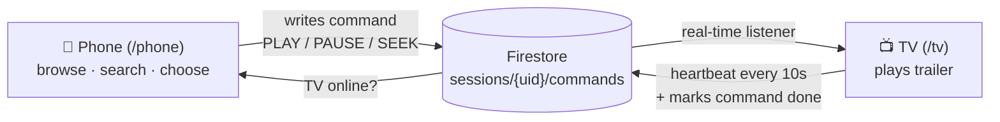

# PickToPlay

**Use your phone as a remote for the TV app, not as a casting device.**

PickToPlay is a prototype that tests one question: *is choosing what to watch on your phone and sending it to the TV faster than browsing on the TV with arrow keys?*

> **Status:** 🚧 In progress. Milestones 1–5 of 6 are done (sign-in, phone and TV browse and search, trailer player, Send to TV, and test instrumentation). There are no test results yet. They'll be posted here exactly as measured.

## The problem

Choosing something to watch on a TV is slow. You move one tile at a time with a D-pad, type search terms on an on-screen keyboard, and read synopses from across the room. Phones fix most of this, and casting used to bridge the two.

In late 2025, a major streaming service removed phone casting for most devices without giving a reason. Reporting suggested it wanted more control over the TV interface, viewer data, and ads. Casting hands playback to a separate receiver, so the platform loses some of that control.

## The thesis: a remote, not casting

| | Casting | **Phone as remote (this prototype)** |
|---|---|---|
| Where playback runs | A separate receiver | **The TV app itself** |
| Who controls the TV UI | Split | **The TV app** |
| Viewer data and ads | Partly lost | **Stay with the platform** |
| What the phone is good at | Starting playback | **Browsing, searching, and choosing** |

The phone handles discovery, where its keyboard, touch scrolling, and readable text help most. The TV keeps playback, so the platform keeps the experience.

## How it works



- The phone and TV are signed in to the **same account**.
- The TV sends a **heartbeat** every 10 seconds. The phone shows **Send to TV** only when a TV has checked in within the last 30 seconds.
- The phone writes a **command** with its own ID. The TV runs it once, marks it `done` or `failed`, and ignores anything older than 30 seconds.
- A desktop browser stands in for the TV. Titles come from TMDB, and trailers play through YouTube.

## Experiment plan

- **Metric:** *time-to-play*, the seconds from opening browse to playback starting.
- **Comparison:** TV-only arrow-key browsing (control) vs. choosing on the phone and sending to the TV.
- **Method:** 10–15 people each try both versions, in alternating order. The facilitator starts each attempt at `/tv/test` (participant code + variant); it ends at the first trailer playback, when the facilitator presses **Gave up**, or after 3 minutes (counted as an abandon). `/results` shows the medians and every attempt, and exports a CSV.
- **Reported:** median time-to-play for each version, and how many people quit without choosing.
- **Honesty rule:** results are reported as measured, including anything that didn't work.

## Results

_Not yet run._

## Key tradeoffs

- **Firestore real-time listeners instead of WebSockets:** there's no server to run, and sign-in, security rules, and the event log all live in one place. The cost is somewhat higher latency than a dedicated socket.
- **Trailers only:** this is enough to measure *choosing*, which is what the prototype tests. It needs no content licensing.
- **In-app volume only:** controlling the TV's hardware volume needs device-level access that a browser doesn't have.

## Roadmap

| # | Milestone | Status |
|---|---|---|
| 1 | Firebase project, auth, both routes rendering | ✅ Done |
| 2 | TMDB rows and title detail on the phone page | ✅ Done |
| 3 | TV page: arrow-key rows and trailer player | ✅ Done |
| 4 | Send to TV via Firestore commands | ✅ Done |
| 5 | Event logging and time-to-play results page | ✅ Done |
| 6 | Run the 10–15 person test; publish results | ⏳ Next |

## Run it locally

**You'll need:** Node 20+, and Java 11+ for the Firebase emulators.

```bash
git clone https://github.com/mansichud/pick-to-play.git
cd pick-to-play
npm install
cp .env.example .env.local   # VITE_USE_EMULATORS=true works without a Firebase project
```

In two terminals:

```bash
npm run emulators   # Auth + Firestore emulators; UI at http://localhost:4000
npm run dev         # App at http://localhost:5173
```

Open **http://localhost:5173/tv** in one window and **http://localhost:5173/phone** in another. Create an account from the sign-in screen. Emulator data resets each time the emulators restart.

## Tech stack

React + Vite · Firebase Auth and Firestore · TMDB API · YouTube IFrame Player API

## Attribution

This product uses the TMDB API but is not endorsed or certified by TMDB.

PickToPlay is an independent prototype. It isn't affiliated with, or endorsed by, any streaming service.
